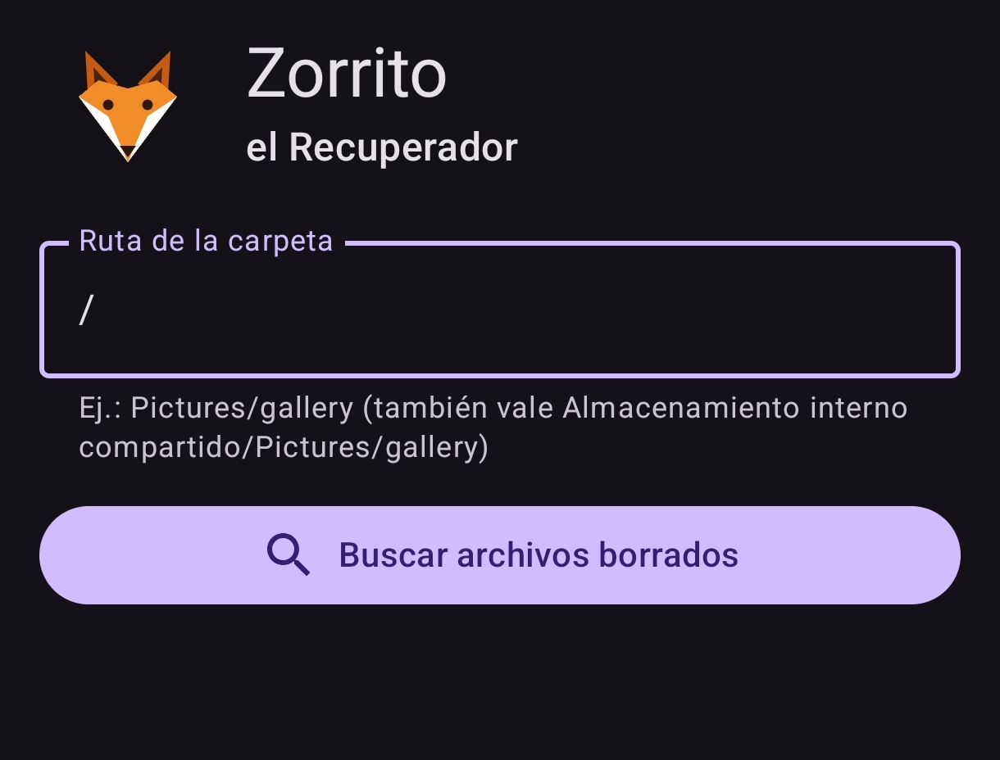
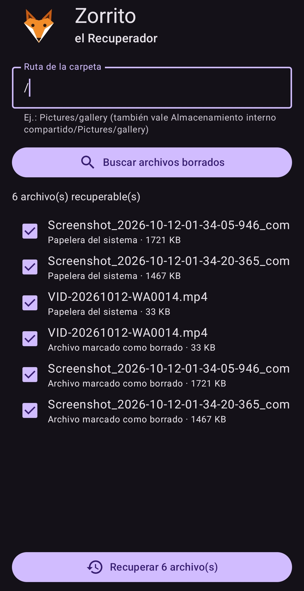

# ZorritoRecuperador
# 🦊 Zorrito el Recuperador

**Recuperación de archivos eliminados en Android (sin root)**

[](LICENSE)
[](#-requisitos)
[](#️-detalles-técnicos)
[](https://github.com/zil00g/ZorritoRecuperador/releases/latest)

**Zorrito el Recuperador** es una app para Android que busca y recupera fotos y archivos borrados que todavía siguen en el móvil: los que están en la **papelera del sistema** y los que Android ha **marcado como borrados** pero aún no ha eliminado del todo.

Sencilla, en español, sin anuncios y **sin conexión a Internet**: la app no pide permiso de red, así que nada sale de tu teléfono.

<p align="center">
  
  &nbsp;&nbsp;
  
</p>

<p align="center"><sub>Pantalla inicial · Resultados de la búsqueda (tema oscuro)</sub></p>

---

## ✨ Qué hace

- **Busca en la papelera del sistema** (MediaStore) los archivos enviados a la papelera desde la galería u otras apps.
- **Detecta archivos marcados como borrados** (los que Android renombra con el prefijo `.trashed-`) dentro de la carpeta que elijas.
- **Te deja elegir qué recuperar**: lista con casilla, nombre, tamaño en KB y origen de cada archivo («Papelera del sistema» o «Archivo marcado como borrado»).
- **Recupera en lote**: restaura todos los archivos seleccionados con un solo botón y te dice cuántos se han recuperado.
- **No sobrescribe nada**: si hace falta, el archivo restaurado se guarda con el sufijo `_recuperado`.
- **Tema claro y oscuro** automático, según el ajuste del sistema.

## 📱 Requisitos

| | |
|---|---|
| Android | 11 (API 30) o superior |
| Probada para | Android 14 (API 34) |
| Permisos | Acceso a todos los archivos (`MANAGE_EXTERNAL_STORAGE`) |
| Root | No hace falta |

## 🚀 Cómo se usa

1. **Descarga el APK** desde la página de [**Releases**](https://github.com/zil00g/ZorritoRecuperador/releases/latest) e instálalo. Puede que Android te pida permitir la instalación desde orígenes desconocidos.
2. **Abre Zorrito** y pulsa **«Conceder acceso»**. Se abrirá el ajuste del sistema donde tienes que activar *Permitir acceso para gestionar todos los archivos*. Vuelve a la app.
3. **Escribe la ruta de la carpeta** donde buscar. Por defecto es `Pictures/gallery`.
   Puedes escribirla de varias formas y la app la entiende igual:
   - `Pictures/gallery`
   - `Almacenamiento interno compartido/Pictures/gallery`
   - `/sdcard/Pictures/gallery`
   - `/storage/emulated/0/Pictures/gallery`
   - `/` para buscar en **todo** el almacenamiento interno
4. Pulsa **«Buscar archivos borrados»**. Verás cuántos archivos recuperables hay, con su origen y tamaño. Un mismo archivo puede aparecer dos veces, una por cada origen («Papelera del sistema» y «Archivo marcado como borrado»).
5. **Marca los que quieras** y pulsa **«Recuperar N»**. Al terminar verás «Recuperados X de N».

## ⚠️ Limitaciones

Zorrito recupera archivos que **todavía existen** en el almacenamiento, aunque estén ocultos o en la papelera. **No puede recuperar** archivos borrados definitivamente (papelera vaciada, o pasados los ~30 días en que Android la vacía sola). Para eso haría falta acceso root y herramientas forenses, que esta app no usa.

Si no encuentra nada, mostrará:
> *No se encontró nada recuperable en esa ruta. Si se borró definitivamente, esta app no puede recuperarlo sin root.*

Consejo: si acabas de borrar algo importante, usa el móvil lo menos posible hasta recuperarlo.

## 🔒 Privacidad

- La app **no tiene permiso de Internet**: no envía datos a ningún sitio.
- No recoge estadísticas, no muestra publicidad y no crea cuentas.
- El permiso de acceso a todos los archivos se usa **solo** para buscar y restaurar archivos en la carpeta que tú indicas.

## 🛠️ Detalles técnicos

| | |
|---|---|
| Lenguaje | Kotlin |
| Interfaz | Jetpack Compose + Material 3 |
| Paquete | `com.example.filerescue` |
| Versión | 1.0 (código 1) |
| `minSdk` / `targetSdk` | 30 / 34 |

**Cómo funciona por dentro:**

- **Papelera del sistema:** consulta `MediaStore` con `QUERY_ARG_MATCH_TRASHED` filtrando por `relative_path`, y para restaurar pone `IS_TRASHED = 0` en el elemento.
- **Archivos marcados como borrados:** recorre la carpeta buscando archivos cuyo nombre empieza por `.trashed-` y, para restaurarlos, les quita ese prefijo renombrándolos.

**Estructura del código:**

```
com.example.filerescue
├── MainActivity.kt   → pantalla principal (Compose): permisos, ruta, lista y botones
├── Recovery.kt       → lógica de búsqueda y restauración (MediaStore + archivos .trashed-)
└── Fox.kt            → logotipo del zorrito dibujado con Canvas
```

### Compilar desde el código fuente

Necesitas [Android Studio](https://developer.android.com/studio) (o el JDK 17 y el SDK de Android 34).

```bash
git clone https://github.com/zil00g/ZorritoRecuperador.git
cd ZorritoRecuperador
./gradlew assembleDebug
# El APK queda en app/build/outputs/apk/debug/app-debug.apk
```

## 🤝 Contribuir

¿Has encontrado un fallo o tienes una idea? Abre una [**issue**](https://github.com/zil00g/ZorritoRecuperador/issues) contando qué disppositivo y versión de Android usas y qué ha pasado.

Si quieres aportar código:

1. Haz un *fork* del repositorio.
2. Crea una rama: `git checkout -b mi-mejora`.
3. Haz tus cambios y un *commit* con un mensaje claro.
4. Abre un *pull request*.

Al contribuir aceptas que tu código se publique bajo la misma licencia AGPL v3.

## 📄 Licencia

Este proyecto es software libre y se distribuye bajo la **GNU Affero General Public License v3.0** (AGPL-3.0). Consulta el archivo [`LICENSE`](LICENSE).

En resumen: puedes usar, estudiar, modificar y compartir la app, pero si distribuyes una versión modificada (o la ofreces a otros a través de una red), debes publicar también su código fuente bajo la misma licencia.

La app usa bibliotecas de terceros (Kotlin, AndroidX y Jetpack Compose) distribuidas bajo la **licencia Apache 2.0**, que mantienen sus propias condiciones.

---

Hecho con 🧡 por [@zil00g](https://github.com/zil00g) — un zorrito que no deja ninguna foto atrás.
